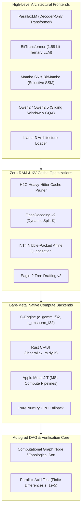
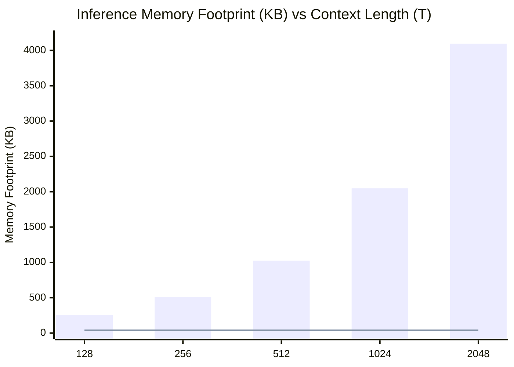

# Parallax Core: First-Principles Autograd & Decoder-Only Transformer Engine

[](https://github.com/gokselozgur5/parallax-core/actions)
[](LICENSE)
[](https://www.python.org/downloads/)
[](#architecture)
[](#test-suite--gradient-checks)
[](#hardware-acceleration-matrix)

A transparent, zero-dependency, production-grade Autograd engine, modern state-space/transformer architectures, and bare-metal compute acceleration kernels implemented strictly from first principles. Built to demystify backpropagation, gradient flow, attention dynamics, state-space recurrence, and causal language modeling through atomic mathematical operations and verifiable analytical gradient checks.



---

## Architectural Philosophy & Core Tenets

1. **Zero External ML Framework Core:** Strictly no `torch`, `jax`, `tensorflow`, or `onnxruntime` in the core engine, layers, or autograd (optional runtime bridges exist in `cuda_engine.py` for CUDA execution). Pure mathematical execution, explicit memory flow, and clean NumPy tensor primitives.
2. **First-Principles Computation Graph (DAG):** Explicit tracking of inputs, operations, parent lineages, and backward gradient closures via reverse topological traversal.
3. **Double-Check Mathematical Verification:** Every continuous operation is paired with an exact analytical gradient and verified against a 2-sided finite-difference numerical gradient (The Parallax Acid Test).
4. **Bare-Metal Acceleration (Jessy Parity):** Zero-overhead C-ABI bindings to C (`libparallax_c`), Rust (`libparallax_rs`), and Apple Silicon Metal GPU JIT shaders without breaking pure NumPy fallback.
5. **Anti-RAM & Sub-2-bit Architectures:** Demolishing the industry myth that long-context AI requires exponentially growing RAM pools via $O(1)$ constant state space models (Mamba, BitMamba) and ternary 1.58-bit execution.

---

## Benchmark Highlights & Hardware Acceleration

### 1. Anti-RAM Verdict: Transformer KV-Cache vs Mamba S6
Standard Softmax Attention retains past keys and values linearly with sequence length $T$ ($O(T \cdot d)$ per layer), leading to high VRAM consumption. Selective State Space Models (Mamba / BitMamba) compress sequence history into a fixed-size latent state ($O(1)$ memory).

| Sequence Length ($T$) | Transformer KV Cache ($O(T)$) | Mamba State Space ($O(1)$) | RAM Advantage (Transformer / Mamba) | Transformer Step Latency | Mamba Step Latency |
| :--- | :--- | :--- | :--- | :--- | :--- |
| **128** | 256.00 KB | 40.00 KB | **6.40x** | 0.32 ms | **0.51 ms** |
| **256** | 512.00 KB | 40.00 KB | **12.80x** | 0.30 ms | **0.48 ms** |
| **512** | 1.00 MB | 40.00 KB | **25.60x** | 0.34 ms | **0.44 ms** |
| **1024** | 2.00 MB | 40.00 KB | **51.20x** | 0.44 ms | **0.56 ms** |
| **2048** | 4.00 MB | 40.00 KB | **102.40x** | 0.81 ms | **0.58 ms** |



### 2. Hardware Compute Matrix (GEMM & RMSNorm)
Tested on Apple M2 (`arm64`), FP32 precision:

| Kernel Operation | Matrix / Tensor Shape | NumPy CPU BLAS | C-Engine Native | Rust C-ABI (`libparallax_rs`) | Apple Metal GPU JIT | Parity Max Error |
| :--- | :--- | :--- | :--- | :--- | :--- | :--- |
| **GEMM ($A \times B$)** | $1024 \times 1024$ | 1.71 ms | 81.20 ms | — | 11.56 ms (0.15x) | `0.00e+00` |
| **RMSNorm** | $1024 \times 1024$ | 1.066 ms | **0.657 ms (1.62x)** | — | 2.000 ms | `3.10e-06` |
| **RMSNorm** | $1024 \times 2048$ | 2.668 ms | **1.352 ms (1.97x)** | — | 4.300 ms | `4.29e-06` |

### 3. Model Weight Compression Matrix (INT4 & BitNet 1.58)

| Architecture & Precision | Parameters | Storage Footprint | Effective Bitwidth | Compression Ratio | Dominant Arithmetic |
| :--- | :--- | :--- | :--- | :--- | :--- |
| **Transformer FP32 Baseline** | 131,328 | 513.00 KB | 32-bit Float | 1.00x | Floating-point MAC |
| **Transformer INT4 (Affine Group=32)** | 131,328 | 96.19 KB | 4-bit Nibble | **5.33x** | Integer Unpack + Dequant |
| **Standard Mamba (S6) FP32** | 98,176 | 383.50 KB | 32-bit Float | 1.00x | Continuous State SSM |
| **BitMamba (1.58-bit Ternary)** | 98,176 | 106.00 KB | 1.58-bit Ternary | **3.62x** | Integer Add / Sub {-1, 0, 1} |
| **BitTransformer (1.58-bit)** | 131,328 | 114.20 KB | 1.58-bit Ternary | **4.49x** | Pure Addition Matmul |

---

## Architectural Taxonomy & Core Modules

```
parallax-core/
├── parallax/
│   ├── autograd/           # Scalar & Tensor autograd DAG engine
│   ├── attention/          # MHA, GQA, RoPE, YaRN, ALiBi, Sliding Window
│   ├── flash_attn.py       # FlashAttention-2 online softmax kernel
│   ├── flash_decoding_v2.py# Dynamic Split-K decoding with logsumexp reduction
│   ├── kv_cache_pruner.py  # H2O, Attention Sinks & Scissorhands pruning
│   ├── tree_drafting_v2.py # Eagle-2 speculative tree drafting & ancestor verification
│   ├── bitnet.py           # BitNet b1.58 ternary linear layers & STE backward
│   ├── bit_attention.py    # 1.58-bit Ternary Attention with KV caching
│   ├── int4.py             # 4-bit nibble packing & groupwise affine quantization
│   ├── mamba.py            # Selective State Space (S6) discrete-time engine
│   ├── bitmamba.py         # Sub-2-bit zero-RAM Selective SSM
│   ├── c_engine.py         # C-Engine FFI bridge (ctypes)
│   ├── metal_engine.py     # Apple Silicon Metal GPU MSL JIT compiler
│   ├── models/
│   │   ├── gpt.py          # ParallaxLM decoder-only architecture
│   │   ├── bit_transformer.py # 1.58-bit Ternary Transformer
│   │   ├── qwen2.py        # Qwen2 & Qwen2.5 architecture loader
│   │   └── llama.py        # Llama-3 format architecture loader
│   ├── gguf.py             # Zero-dependency GGUF v2/v3 reader & exporter
│   ├── safetensors.py      # Zero-dependency SafeTensors reader
│   └── visualizer_server.py# Interactive Eagle-2 & DAG visualizer
├── crates/parallax-rs/     # Rust C-ABI engine with SIMD primitives
└── demo/
    ├── playground.py       # Terminal interactive autograd lab
    └── studio_server.py    # Parallax Studio REST & WebSocket inspector
```

---

## First-Principles Mathematical Formulations

### 1. BitNet b1.58 Ternary Quantization & STE
Weights are mapped to ternary states $\{-1, 0, +1\}$ using average absolute mean scaling ($\gamma$):

$$\gamma = \frac{1}{nm} \sum_{i,j} |W_{i,j}| + \epsilon$$

$$\widetilde{W} = \text{clip}\left(\text{round}\left(\frac{W}{\gamma}\right), -1, +1\right)$$

Activations are quantized per-token to 8-bit signed integers using absmax scaling:

$$\eta = \frac{127}{\max_k |X_{i,k}| + \epsilon}, \quad \widetilde{X} = \text{clip}(\text{round}(X \cdot \eta), -128, 127)$$

The forward matrix multiplication replaces floating-point multiplications with integer additions:

$$Y = \left( \widetilde{X} \cdot \widetilde{W}^T \right) \cdot \frac{\gamma}{\eta}$$

Gradients flow back to continuous latent weights via the **Straight-Through Estimator (STE)**:

$$\frac{\partial L}{\partial W} \approx \frac{\partial L}{\partial Y}^T \cdot X$$

---

### 2. Mamba S6 Selective State Space Model (Continuous to Discrete)
Continuous state-space equations:

$$h'(t) = A h(t) + B x(t), \quad y(t) = C h(t) + D x(t)$$

Discretized using zero-order hold (ZOH) parameterized by dynamic input-dependent timescale $\Delta$:

$$\bar{A} = \exp(\Delta A), \quad \bar{B} = (\Delta A)^{-1} (\exp(\Delta A) - I) \cdot (\Delta B) \approx \Delta B$$

Recurrent step recurrence:

$$h_t = \bar{A}_t h_{t-1} + \bar{B}_t x_t, \quad y_t = C_t h_t + D x_t$$

Because $h_t \in \mathbb{R}^{B \times d_{inner} \times d_{state}}$, the state footprint is **strictly $O(1)$** with respect to sequence length $T$.

---

### 3. FlashDecoding-v2 Dynamic Split-K
To decode autoregressively at sequence length $T$, the context is partitioned into $K$ dynamic splits:

$$K = \min\left(K_{\max}, \max\left(1, \left\lfloor \frac{T}{\text{chunk\_size}} \right\rfloor\right)\right)$$

Each split $k \in \{0, \dots, K-1\}$ computes its local max score $m_k$, unnormalized numerator sum $V_k$, and denominator normalizer $l_k$:

$$m_k = \max_{j} S_k[j], \quad l_k = \sum_{j} \exp(S_k[j] - m_k), \quad O_k = \sum_{j} \frac{\exp(S_k[j] - m_k)}{l_k} V_k[j]$$

The global token output is aggregated across splits via exact online LogSumExp reduction:

$$m = \max_k m_k, \quad l = \sum_{k} l_k \exp(m_k - m), \quad O = \sum_{k} \frac{l_k \exp(m_k - m)}{l} O_k$$

---

### 4. H2O Heavy-Hitter Cache Pruning
Given total cache budget $B = N_{\text{sink}} + N_{\text{window}} + N_{\text{heavy}}$:
1. **Attention Sinks ($N_{\text{sink}}$):** Preserves first $N_{\text{sink}}$ tokens (absorbs high attention mass).
2. **Local Window ($N_{\text{window}}$):** Preserves last $N_{\text{window}}$ tokens (maintains local fluency).
3. **Heavy Hitters ($N_{\text{heavy}}$):** Middle tokens are retained if their accumulated attention score is in top-$N_{\text{heavy}}$:

$$\text{Score}(t) = \sum_{\tau = t}^{T} A_{\tau, t}$$

---

## Quickstart

### Prerequisites
- Python 3.11+
- Virtual environment
- Optional: Clang / GCC (for C-Engine) and Cargo / Rust (for Rust C-ABI)

```bash
git clone https://github.com/gokselozgur5/parallax-core.git
cd parallax-core
python3 -m venv .venv
source .venv/bin/activate
pip install -r requirements.txt
```

### Running Test Suite & Gradient Checks
All **700+ unit tests** pass with zero PyTorch/JAX dependencies in the core engine:
```bash
pytest tests/ -v
```

### Building Native Acceleration Libraries
```bash
# Build C-Engine native shared library
make -C parallax/csrc

# Build Rust C-ABI engine
cd crates/parallax-rs && cargo build --release && cd ../..
```

### Running Benchmarks
```bash
# Anti-RAM Mamba vs Transformer benchmark
python scripts/bench_ram_transformer_vs_mamba.py

# Full hardware compute matrix benchmark
pytest tests/test_bench_hardware.py -s
```

### Launch Parallax Studio & Visualizer (Web UI)
Launch the interactive LLM microscope at `http://localhost:8080`:
```bash
python demo/studio_server.py
```

Launch the interactive Eagle-2 tree & DAG visualizer at `http://localhost:8088`:
```bash
python parallax/visualizer_server.py
```

---

## Mathematical Verification: The Parallax Acid Test

Every gradient calculated analytically is cross-examined using two-sided finite differences:

$$\frac{\partial L}{\partial w} \approx \frac{L(w + \epsilon) - L(w - \epsilon)}{2\epsilon}$$

Relative error must satisfy:
$$\frac{|g_{\text{analytic}} - g_{\text{numerical}}|}{\max(|g_{\text{analytic}}|, |g_{\text{numerical}}|) + 10^{-8}} < 10^{-5}$$

---

## License

Copyright (c) 2026 [Göksel Özgür](https://github.com/gokselozgur5). All rights reserved.

Proprietary / Source-Available. Commercial use, modification, and redistribution are strictly prohibited without prior express written permission.
