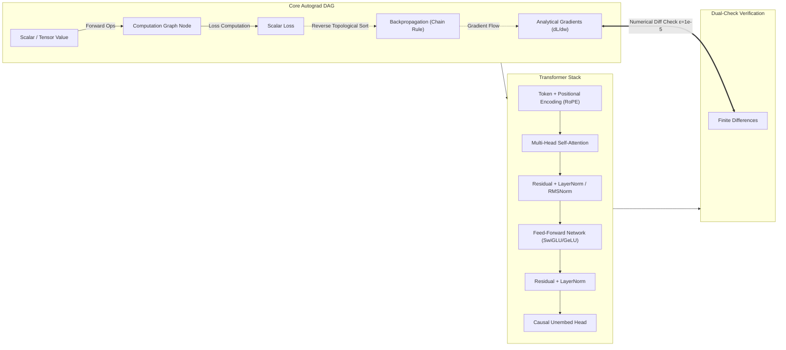

# Parallax Core: First-Principles Autograd & Decoder-Only Transformer Engine

[](https://github.com/gokselozgur5/parallax-core/actions)
[](LICENSE)
[](https://www.python.org/downloads/)
[](#architecture)

A transparent, zero-dependency, production-grade Autograd engine and Decoder-Only Transformer implemented strictly from first principles. Built to demystify backpropagation, gradient flow, attention dynamics, and causal language modeling through atomic mathematical operations and verifiable gradient checks.



---

## Architectural Philosophy

1. **Zero External ML Frameworks:** No `torch`, `jax`, or `tensorflow`. Pure mathematical execution, explicit memory flow, and clean NumPy tensor primitives.
2. **Transparent Computation Graph (DAG):** Explicit tracking of inputs, operations, parent lineages, and backward gradient closures.
3. **Atomic Verification:** Every continuous operation is paired with an analytical gradient and verified against a 2-sided finite-difference numerical gradient.
4. **Production Hygiene:** Strict type hints, modular decoupled components, full test coverage, and benchmark profiles.

---

## Roadmap & Atomic Milestones

| Milestone | Scope & Deliverables | Verification Strategy |
| :--- | :--- | :--- |
| **M1: Scalar Autograd Engine** | `Value` class, primitive ops (`+`, `-`, `*`, `/`, `**`, `neg`), topological sort backward pass | Finite-difference numerical gradient tests |
| **M2: Non-Linear Activations** | `relu`, `gelu`, `tanh`, `sigmoid`, `exp`, `log` with analytical derivatives | Analytic vs numerical gradient unit tests |
| **M3: Tensor Primitives & Broadcasting** | N-dimensional tensor support, broadcasting rules, matrix multiplication (`matmul`) | Matrix calculus verification against explicit Jacobian loops |
| **M4: Neural Network Modules** | `Module`, `Parameter`, `Linear`, `LayerNorm`, `RMSNorm`, `Dropout` | Overfitting a single batch, parameter update sanity |
| **M5: Attention & Positional Encoding** | Scaled Dot-Product Attention, Causal Masking, Multi-Head Attention, RoPE | Attention weight distribution & causality leakage check |
| **M6: Transformer Blocks & Architecture** | Decoder-only Transformer block, Residual stream stability, SwiGLU FFN | Gradient norm tracking across 12-block depth |
| **M7: Causal Language Modeling & Tokenizer** | BPE / Character-level Tokenizer, cross-entropy loss, autoregressive text generation | Greedy & top-k/top-p sampling verification |
| **M8: Execution Tracing & Visualization** | Graphviz/Mermaid computation graph exporter, attention map heatmaps | Renderable SVG/DOT computation graph dumps |

---

## Quickstart

### Prerequisites
- Python 3.11+
- Virtual environment

```bash
git clone https://github.com/gokselozgur5/parallax-core.git
cd parallax-core
python3 -m venv .venv
source .venv/bin/activate
pip install -r requirements.txt
```

### Running Test Suite & Gradient Checks
```bash
pytest tests/ -v
```

### Launch Interactive Playground Lab
Explore gradient descent, causal attention weights, RoPE angles, and micro-LM training in real-time:
```bash
python demo/playground.py
```

---

## Mathematical Verification: The Parallax Acid Test

Every gradient calculated analytically is cross-examined using two-sided finite differences:

$$\frac{\partial L}{\partial w} \approx \frac{L(w + \epsilon) - L(w - \epsilon)}{2\epsilon}$$

Relative error must satisfy:
$$\frac{|g_{\text{analytic}} - g_{\text{numerical}}|}{\max(|g_{\text{analytic}}|, |g_{\text{numerical}}|) + 10^{-8}} < 10^{-5}$$

---

## License
MIT License. Authored and maintained by [Göksel Özgür](https://github.com/gokselozgur5).
