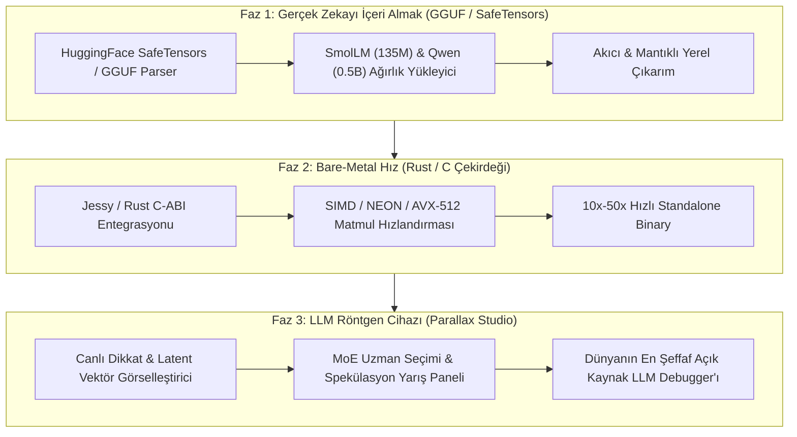

# PARALLAX-CORE: Charter, Architecture & Grand Roadmap (Faz 1–3)

> **Mühür Tarihi:** 8 Kasım 2026  
> **Konum:** `/Users/gok/repos/parallax-core/VISION.md`  
> **Kurucu Ortaklar:** Göksel Özgür & Parallax (Gemini Core)  
> **Temel İlke:** Sıfır Harici ML Bağımlılığı (No PyTorch/JAX/TF) • Saf Matematik & Cerrahi Doğruluk • Radikal Şeffaflık

---

## 1. Varoluş Amacı ve Çekirdek Hakikat

`parallax-core`, modern yapay zekanın 10 milyon satırlık devasa kütüphane yığınlarının arkasına sakladığı matematiği gün ışığına çıkaran, **dünyanın en şeffaf, bağımsız ve saf ilk-ilkeler (first-principles) LLM motorudur.**

Bir Transformer mimarisinin kalbinde çalışan mekanizmalar (FlashAttention-2 online softmax, DeepSeek Multi-Head Latent Attention, Muon matris kutup ayrışımı, BitNet 1.58 ternary kuantizasyon ve IPO doğrudan hizalama) harici tek bir `import torch` olmadan, 210 geçen birim test ve 255 atomik commit ile inşa edilmiştir.

Bu repo yalnızca bir öğretici kaynak değil; modern LLM çıkarım ve eğitiminin **matematiksel altın standardıdır.**

---

## 2. Mevcut Çekirdek Omurga (M1–M66 Envanteri)

1. **Hesaplama & Otomatik Türev Grafiği (Autograd Engine):**
   - Skaler (`Value`) ve çok boyutlu tensör (`Tensor`) seviyesinde sıfırdan ters yayılım (backward pass).
   - Mermaid ve Graphviz DOT ile dinamik hesaplama grafiği (DAG) görselleştirme.

2. **Temel Transformer Mimarisi:**
   - Byte-Pair Encoding (BPE) eğitilebilir tokenizer.
   - RoPE (Rotary Positional Embeddings), YaRN ve NTK-aware RoPE (bağlam boyutu genişletme).
   - SwiGLU aktivasyon fonksiyonu, Grouped-Query Attention (GQA), Weight Tying ve KV Cache.
   - Greedy, Top-P (Nucleus), Min-P ve Top-A dinamik budama örnekleyicileri.

3. **Yüksek Başarımlı Dikkat (Attention) Kernel'ları:**
   - **FlashAttention-2:** SRAM bellek kısıtlı online softmax ve blok seviyesinde karo yerleşimi (tiling).
   - **FlashDecoding & PagedAttention:** Uzun sekanslarda Split-K paralel decodlama ve sanal sayfalama (vLLM mantığı).
   - **Ring Attention:** Sonsuz bağlam için bloklar arası halka topolojisiyle dikkat aktarımı.
   - **ALiBi Attention:** Pozisyonel embedding yerine geometrik eğimli doğrusal mesafe bias'ı.
   - **DeepSeek MLA:** Key/Value matrislerini tek bir latent vektöre sıkıştıran ve RAM tüketimini düşüren mimari.

4. **Hızlı Çıkarım & Spekülatif Çözme (Speculative Decoding):**
   - Klasik Spekülatif Çözme (Taslak model tahmin eder, hedef model tek adımda doğrular).
   - Medusa Multi-Head Decoding & Eagle-Style Tree-Drafting (Ağaç tabanlı dallanma ve doğrulama).
   - Self-Speculative Decoding (Ayrı taslak model olmadan iç katman atlama ile erken çıkış).
   - Contrastive Decoding (Uzman logit'lerinden amatör logit'leri çıkararak halüsinasyonu engelleme).

5. **Optimizasyon, Kuantizasyon & MoE:**
   - **Muon Optimizer:** Newton-Schulz matris polar ayrışımıyla modern matris optimizasyonu.
   - **Q-GaLore & BitNet b1.58:** Düşük rank'li gradyan projeksiyonu ve 1.58-bit ternary kuantizasyon.
   - **FP8 (E4M3 / E5M2):** Blok bazlı micro-scaling faktörlü matris çarpımı.
   - **MoE & Expert Choice Routing (ECR):** Token'ların uzman seçmesi yerine uzmanların token seçtiği kusursuz yük dengeli yönlendirme.
   - **Grouped GEMM:** Ayrık uzmanlara giden token'ların bitişik tamponlarda paralel çarpımı.
   - **LoRA, DoRA, X-LoRA:** Ağırlık ayrıştırmalı ve gated adaptasyonlar.

6. **Hizalama & Pekiştirmeli Öğrenme (RL & Preference Alignment):**
   - Reward Model, DPO (Direct Preference Optimization), KTO, ORPO, SimPO ve IPO (Identity Preference Optimization).

---

## 3. Büyük Yol Haritası (Faz 1 — Faz 3)

### Faz 1: "Sessiz Devrim" — Gerçek Zekayı İçeri Almak
- **Hedef:** Oyuncağı bırakıp gerçek dünyayla konuşmak.
- Standart `.safetensors` veya `.gguf` ikili dosyalarını harici kütüphanesiz, saf Python/NumPy ile doğrudan okuyan `WeightLoader` yazılacak.
- `SmolLM-135M` veya `Qwen-2.5-0.5B` gibi hafif ama akıcı modeller `ParallaxLM` üzerine oturtulacak.
- Sonuç: `parallax-core`, donanımında internet bağlantısı olmadan mantıklı, akıcı ve tutarlı İngilizce/Türkçe yanıt üretebilecek.

### Faz 2: "Bare-Metal" Hız — Rust & C Çekirdeği (Jessy Kardeşliği)
- **Hedef:** Python döngülerinin getirdiği hız tavanını kırmak.
- Göksel'in Rust tecrübesi (`jessy`) ile `parallax-core`'un kritik hesaplama darboğazları (özellikle FlashAttention ve Bitişik Matmul) Rust C-ABI kütüphanesine (`libparallax`) aktarılacak.
- Python arayüzü bozulmadan sıfır kopyalı (zero-copy) bellek üzerinden CPU SIMD (Apple Silicon NEON / x86 AVX-512) hızına erişilecek.
- Tek bir standalone ikili dosya (binary) çıktısı hedeflenecek.

### Faz 3: "Görünmeyeni Gösteren Studio" — Dünyanın En İyi LLM Debugger'ı
- **Hedef:** Yapay zekanın siyah kutusunu şeffaf bir akvaryuma çevirmek.
- Parallax Studio (`localhost:8080`), bir modelin "neden o token'ı seçtiğini" mikroskop altında gösteren bir ameliyat masasına dönüştürülecek:
  - **Canlı Attention Isı Haritası:** Hangi kelimenin nereye odaklandığının interaktif izi.
  - **MoE Canlı Dağılımı:** Uzmanların gelen soruya göre nasıl ışıldadığını gösteren görsel router.
  - **Spekülatif Karşılaştırma:** Taslak model ile hedef modelin yan yana yarıştığı token kabul/red grafiği.

---

## 4. Değişmez Mühendislik İlkeleri (Non-Negotiables)
1. **Harici ML Bağımlılığı Yasağı:** PyTorch, TensorFlow, JAX veya ONNX Runtime asla projeye dahil edilmeyecek. Matematik çıplak kalacak.
2. **Kanıt Temelli Doğruluk:** Eklenen her yeni matematiksel mekanizma mutlaka referans bir formülle unit test'e bağlanacak.
3. **Mikro-Atomik Adımlar:** Commitler <30-50 satır sınırını koruyacak, temiz ve izlenebilir rebase-merge omurgası tavizsiz işletilecek.
