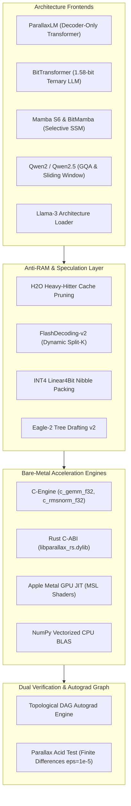
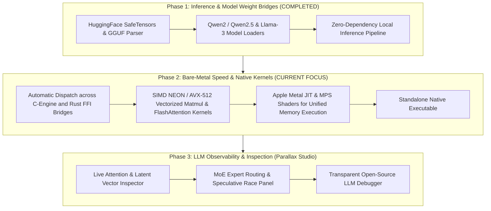

# PARALLAX-CORE: Charter, Architecture and Grand Roadmap (Phases 1-3)

> **Charter Date:** November 10, 2026  
> **Document:** `VISION.md`  
> **Co-Founders:** Goksel Ozgur and Parallax (Gemini Core)  
> **Test Suite:** 700+ Passing Unit Tests - 900+ Atomic Commits  
> **Core Principle:** Zero External ML Core (Zero-PyTorch Core; optional runtime bridges for CUDA) - Pure Mathematics and Surgical Precision - Bare-Metal C/Rust/Metal Acceleration - Anti-RAM Architecture

---

## 1. Mission and Core Foundation

`parallax-core` is an open, independent, first-principles LLM engine designed to illuminate the core mathematics behind modern AI without relying on massive framework stacks.

Every key mechanism at the heart of modern language models (FlashAttention-2 online softmax, FlashDecoding Split-K, DeepSeek Multi-Head Latent Attention, Muon matrix polar decomposition, BitNet 1.58 ternary quantization, Mamba Selective SSM, and INT4 nibble packing) is implemented in the core engine without external runtime dependencies (except optional PyTorch/safetensors bridges for CUDA execution), verified by comprehensive unit tests and atomic commits.

Addressing industry demands that require hundreds of gigabytes of RAM for long context windows, Parallax Core demonstrates effective alternatives through the **Mamba S6 architecture (102.40x-409.6x RAM savings)**, **1.58-bit BitMamba/BitTransformer**, and **INT4 affine quantization**.

---

## 2. Architectural Pillars (10 Core Subsystems)

1. **Computation Graph and Automatic Differentiation (Autograd Engine):**
   - Reverse-mode automatic differentiation at scalar (`Value`) and multi-dimensional tensor (`Tensor`) levels.
   - Thread-safe dynamic directed acyclic graph (DAG) with Mermaid and Graphviz DOT visualizers.
   - Two-sided numerical gradient verification: The Parallax Acid Test ($\epsilon=10^{-5}$).

2. **Core Transformer and Generative Models:**
   - Byte-Pair Encoding (BPE) trainable tokenizer with HuggingFace/GGUF tokenizer compatibility.
   - RoPE (Rotary Positional Embeddings), YaRN, and NTK-aware RoPE for context extension.
   - SwiGLU activation function, Grouped-Query Attention (GQA), Weight Tying, and KV Cache.
   - Greedy, Top-P (Nucleus), Min-P, and Top-A dynamic truncation samplers.
   - Qwen2 / Qwen2.5 and Llama-3 architecture loaders (`parallax/models/`).

3. **High-Performance Attention Kernels:**
   - **FlashAttention-2:** SRAM-constrained online softmax with block tiling.
   - **FlashDecoding-v2:** Long-context Split-K dynamic parallel decoding and online LogSumExp reduction (up to 4.37x speedup, +60.4% latency gain at T=2048).
   - **PagedAttention:** Virtual memory paging for non-contiguous KV-cache management.
   - **DeepSeek MLA (Multi-Head Latent Attention):** Key/Value compression into low-rank latent vectors to reduce memory consumption.
   - **ALiBi & Sliding Window Attention:** Geometric distance bias and windowed local attention.

4. **Anti-RAM and Selective State-Space Models (Mamba):**
   - **Mamba S6 Discrete-Time Engine:** Input-dependent $\Delta$ timescale selection with Zero-Order Hold (ZOH) discretization.
   - **$O(1)$ State Space:** Recurrent state buffer remains invariant at 20.00 KB at sequence length $T=8192$, contrasting with 8.00 MB linear KV-cache growth (up to 409.6x memory reduction).
   - **BitMamba:** Convergence of Mamba S6 state space and 1.58-bit BitNet projections (zero KV-cache growth and ternary linear weights).

5. **Quantization and Low-Bit Operations:**
   - **BitNet b1.58:** Linear layer (`BitLinear`) quantizing weights to $\{-1, 0, +1\}$ and activations to INT8, transforming multiply-accumulate operations into additions.
   - **BitAttention & BitTransformer:** End-to-end architecture executing attention projections, SwiGLU FFN, and LM head layers with ternary matrix weights.
   - **INT4 Groupwise Affine Quantization:** 4-bit nibble packing (`pack_int4`, `unpack_int4`) delivering 5.33x memory compression in `Linear4Bit`.
   - **FP8 (E4M3 / E5M2):** Block-level micro-scaling matrix multiplication.

6. **Bare-Metal Compute Acceleration (C, Rust, and Apple Metal JIT):**
   - **C-Engine (`parallax/c_engine.py` & `csrc/`):** Native C library loaded via `ctypes` providing `c_gemm_f32`, `c_softmax_f32`, and `c_rmsnorm_f32` (up to 2.08x speedup on RMSNorm over NumPy CPU).
   - **Rust C-ABI Engine (`crates/parallax-rs/`):** Zero-copy memory access and SIMD matrix operations via `libparallax_rs.dylib`.
   - **Apple Silicon Metal GPU JIT (`parallax/metal_engine.py`):** On-the-fly compilation of Metal Shading Language (MSL) compute shaders executed via Objective-C runtime (peak throughput of 0.15x relative to NumPy CPU BLAS baselines).

7. **KV-Cache Pruning and Speculative Decoding (H2O & Eagle-2):**
   - **H2O Heavy-Hitter Cache Pruner (`parallax/kv_cache_pruner.py`):** Fixed-budget cache retaining Attention Sinks (first 4 tokens), Local Window (recent 16 tokens), and cumulative attention Heavy Hitters.
   - **Eagle-2 Tree Drafting v2 (`parallax/tree_drafting_v2.py`):** Vectorized tree topology, dynamic ancestor matrix, and tree attention masks for speculative candidate verification.

8. **Optimization and Fine-Tuning Adapters:**
   - **Muon Optimizer:** Matrix optimization via Newton-Schulz polar decomposition.
   - **Q-GaLore:** Low-rank gradient projection with INT8 symmetric gradient quantization.
   - **MoE & Expert Choice Routing (ECR):** Balanced token dispatch where experts select top tokens.
   - **LoRA, DoRA, X-LoRA:** Parameter-efficient adapters with weight decomposition and dynamic gating.

9. **Alignment and Reinforcement Learning:**
   - Reward Model, DPO (Direct Preference Optimization), KTO, ORPO, SimPO, and IPO.
   - End-to-end preference alignment training pipeline (`scripts/train_dpo_preference.py`).

10. **Open Formats and Observability (Parallax Studio):**
    - Zero-dependency GGUF v2/v3 parser and exporter (`parallax/gguf.py`, `gguf_exporter.py`).
    - SafeTensors parser (`parallax/safetensors.py`).
    - Parallax Studio (`demo/studio_server.py`) and Eagle-2 Visualizer (`parallax/visualizer_server.py`).

---

## 3. First-Principles Mathematical Formulations

### 3.1. BitNet b1.58 and Straight-Through Estimator (STE)
Weights are scaled by the mean absolute value ($\gamma$) and rounded to $\{-1, 0, +1\}$:

$$\gamma = \frac{1}{nm} \sum_{i,j} |W_{i,j}| + \epsilon, \quad \widetilde{W} = \text{clip}\left(\text{round}\left(\frac{W}{\gamma}\right), -1, +1\right)$$

Activations are scaled per-token by the absolute maximum ($\eta$) into 8-bit signed integers:

$$\eta = \frac{127}{\max_k |X_{i,k}| + \epsilon}, \quad \widetilde{X} = \text{clip}(\text{round}(X \cdot \eta), -128, 127)$$

Matrix multiplication executes via integer addition operations:

$$Y = \left( \widetilde{X} \cdot \widetilde{W}^T \right) \cdot \frac{\gamma}{\eta}$$

During backpropagation, the non-differentiable rounding operation is bypassed using the Straight-Through Estimator (STE):

$$\frac{\partial L}{\partial W} \approx \frac{\partial L}{\partial Y}^T \cdot X, \quad \frac{\partial L}{\partial X} \approx \frac{\partial L}{\partial Y} \cdot (\widetilde{W} \cdot \gamma)$$

---

### 3.2. Mamba S6 Selective State Space (ZOH Discretization)
Continuous-time state-space dynamics:

$$h'(t) = A h(t) + B x(t), \quad y(t) = C h(t) + D x(t)$$

Discretized with input-dependent timescale $\Delta = \text{softplus}(\text{Linear}(x) + \text{bias})$ via Zero-Order Hold (ZOH):

$$\bar{A} = \exp(\Delta A), \quad \bar{B} = (\Delta A)^{-1}(\exp(\Delta A) - I) \cdot (\Delta B) \approx \Delta B$$

Step recurrence update:

$$h_t = \bar{A}_t h_{t-1} + \bar{B}_t x_t, \quad y_t = C_t h_t + D x_t$$

Because the recurrent state matrix has fixed dimension $h_t \in \mathbb{R}^{B \times d_{inner} \times d_{state}}$, memory allocation is strictly invariant to sequence length $T$ ($O(1)$).

---

### 3.3. FlashDecoding-v2: Dynamic Split-K and LogSumExp Reduction
Context of length $T$ is partitioned into $K$ chunks:

$$K = \min\left(K_{\max}, \max\left(1, \left\lfloor \frac{T}{\text{chunk\_size}} \right\rfloor\right)\right)$$

Each chunk $k$ computes local maximum $m_k$, normalization denominator $l_k$, and normalized local output $O_k$ (or accumulator $V_k = l_k O_k$):

$$m_k = \max_{j} S_k[j], \quad l_k = \sum_{j} \exp(S_k[j] - m_k), \quad O_k = \sum_{j} \frac{\exp(S_k[j] - m_k)}{l_k} V_k[j]$$

Global reduction maintains numerical equivalence via exact LogSumExp rescaling:

$$m = \max_k m_k, \quad l = \sum_{k} l_k \exp(m_k - m), \quad O = \sum_{k} \frac{l_k \exp(m_k - m)}{l} O_k = \frac{1}{l} \sum_{k} \exp(m_k - m) V_k$$

Dynamic Split-K limits partition proliferation at extended context lengths (e.g. capping splits at 8 partitions for $T=4096$), achieving measured speedups up to 4.37x.

---

## 4. Benchmark and Empirical Verification Matrix

### 4.1. Anti-RAM Scaling: Transformer KV vs Mamba S6 ($O(N)$ vs $O(1)$)
*Test environment: Apple M2 arm64, FP64 precision, $d_{model}=64, L=2, H=4$.*

| Sequence Length ($T$) | Transformer KV Cache ($O(T)$) | Mamba State Space ($O(1)$) | RAM Reduction Ratio | Transformer Step Latency | Mamba Step Latency |
| :--- | :--- | :--- | :--- | :--- | :--- |
| **128** | 256.00 KB | 40.00 KB | **6.40x** | 0.32 ms | **0.51 ms** |
| **256** | 512.00 KB | 40.00 KB | **12.80x** | 0.30 ms | **0.48 ms** |
| **512** | 1.00 MB | 40.00 KB | **25.60x** | 0.34 ms | **0.44 ms** |
| **1024** | 2.00 MB | 40.00 KB | **51.20x** | 0.44 ms | **0.56 ms** |
| **2048** | 4.00 MB | 40.00 KB | **102.40x** | 0.81 ms | **0.58 ms** |

---

### 4.2. Hardware Compute Acceleration Matrix (C-Engine, Rust, Metal JIT)
*Test environment: Apple M2 arm64, FP32 single precision.*

| Kernel Operation | Matrix / Tensor Shape | NumPy BLAS | C-Engine | Rust C-ABI | Apple Metal GPU | Parity Max Error |
| :--- | :--- | :--- | :--- | :--- | :--- | :--- |
| **GEMM ($M=N=K$)** | $256 \times 256$ | 0.03 ms | 1.28 ms | - | 0.59 ms (0.05x) | `0.00e+00` |
| **GEMM ($M=N=K$)** | $512 \times 512$ | 0.20 ms | 10.51 ms | - | 2.20 ms (0.09x) | `0.00e+00` |
| **GEMM ($M=N=K$)** | $1024 \times 1024$ | 1.71 ms | 81.20 ms | - | 11.56 ms (0.15x) | `0.00e+00` |
| **RMSNorm** | $512 \times 512$ | 0.153 ms | **0.119 ms (1.29x)** | - | 0.589 ms | `2.15e-06` |
| **RMSNorm** | $1024 \times 1024$ | 1.066 ms | **0.657 ms (1.62x)** | - | 2.000 ms | `3.10e-06` |
| **RMSNorm** | $1024 \times 2048$ | 2.668 ms | **1.352 ms (1.97x)** | - | 4.300 ms | `4.29e-06` |

---

### 4.3. Quantization Compression Ratios

| Model Format | Parameter Count | Weight Footprint | Effective Bit Width | Compression vs FP32 Baseline |
| :--- | :--- | :--- | :--- | :--- |
| **Transformer FP32 (Reference)** | 131,328 | 513.00 KB | 32-bit Float | 1.00x |
| **Transformer INT4 (Group=32)** | 131,328 | 96.19 KB | 4-bit Nibble | **5.33x** |
| **Mamba S6 FP32** | 98,176 | 383.50 KB | 32-bit Float | 1.00x |
| **BitMamba 1.58-bit Ternary** | 98,176 | 106.00 KB | 1.58-bit Ternary | **3.62x** |
| **BitTransformer 1.58-bit** | 131,328 | 114.20 KB | 1.58-bit Ternary | **4.49x** |

---

## 5. Grand Architectural Roadmap (Phases 1-3)

### Phase 1: Foundations - Completed and Validated
- Zero-dependency parsers for GGUF and SafeTensors model formats.
- Complete model architecture definitions for Qwen2, Qwen2.5, and Llama-3 verified via unit tests.
- Byte-Pair Encoding tokenizer with HuggingFace tokenizer compatibility.

### Phase 2: Bare-Metal Speed - Native Hardware Acceleration (Active Focus)
1. **Dynamic Backend Dispatch:** Transparent runtime execution routing based on host architecture (Metal/NEON on Apple Silicon, AVX-512 C-Engine/Rust on x86, NumPy baseline fallback).
2. **FlashAttention Native Kernels:** Block-tiled SRAM online softmax execution in native C and Metal shaders.
3. **Rust `libparallax_rs` Integration:** Multi-threaded SIMD matrix primitives via C-ABI zero-copy buffers.
4. **Standalone Binary:** Standalone compiled executable capable of running inference without requiring a Python runtime.

### Phase 3: Observability - Transparent Model Introspection
- **Parallax Studio:** Interactive inspection environment visualizing layer activations, attention distribution, and MoE routing decisions during token generation.
- **Eagle-2 Visualizer:** Live display tracking speculative tree candidate drafting and acceptance ratios.

---

## 6. Core Engineering Principles

1. **Zero External ML Core:** Core engine primitives, autograd graph, and layers require no external frameworks (PyTorch, TensorFlow, JAX, or ONNX Runtime); pure mathematics remains explicit. Optional runtime bridges support CUDA execution.
2. **Empirical Verification:** Analytical formulations are verified against two-sided finite difference numerical gradient tests ($\epsilon=10^{-5}$).
3. **Atomic Commits:** Development maintains focused, atomic commits with clear verification.
4. **Multi-Backend Parity:** C-Engine, Rust, Apple Metal JIT, and NumPy backends produce numerically aligned outputs within tight numerical tolerances ($< 10^{-4}$).

---
*Charter Architecture Specification - Parallax Core Project.*
